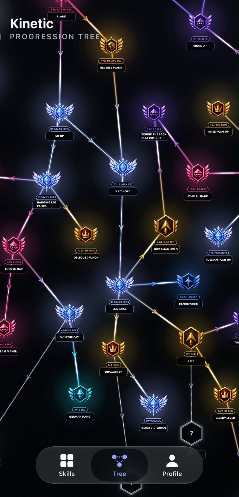
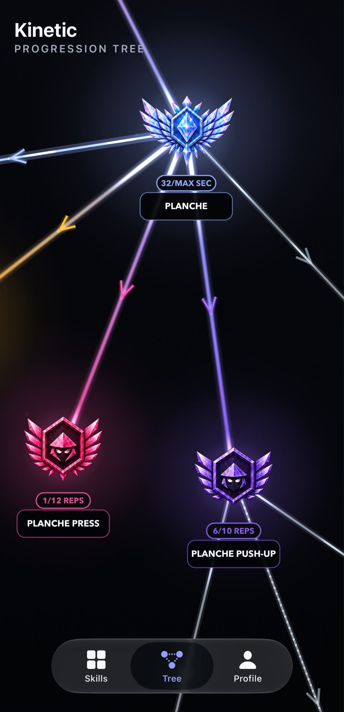

<h1 align="center">Kinetic</h1>

  A visual progression path for learning calisthenics.

  <strong>Harel Meltser · Co-founder &amp; CTO</strong> 
  Native iOS · <a href="https://apps.apple.com/us/app/kinetic-calisthenics-training/id6766755091">Live on the App Store</a>

Kinetic helps people discover calisthenics skills, understand their prerequisites, and track progress through an interactive skill tree.

<table>
  <tr>
    <th align="center">Progression tree</th>
    <th align="center">Skill progression</th>
  </tr>
  <tr>
    <td align="center">
      
    </td>
    <td align="center">
      
    </td>
  </tr>
  <tr>
    <td align="center">Connected skills and prerequisites.</td>
    <td align="center">Ranks and logged performance.</td>
  </tr>
</table>

## What I built

- **Native iOS rebuild.** Proposed and led the move from React Native to native iOS, building the SwiftUI interface and SpriteKit skill tree.
- **Progression logic.** Built the system that maps logged repetitions and hold times to ranks, tracks progress toward the next threshold, and unlocks skills when prerequisites are met.
- **Accounts and subscriptions.** Built and integrated account and progress storage, subscription access, purchase restoration, and product analytics.

## Engineering the tree

The tree is an interactive interface, not a static diagram. SwiftUI handles the surrounding screens, while a retained SpriteKit scene handles the graph and its camera interactions. The scene reuses nodes, adjusts visual detail with zoom, and updates individual skill states without rebuilding the entire graph for each change.

**Built with:** Swift · SwiftUI · SpriteKit · Supabase · RevenueCat · PostHog

## Collaboration

I co-founded Kinetic with [Ilay Gibor](https://github.com/ilaygibor), who leads calisthenics content and growth and also contributes to product and engineering. This page focuses on my engineering responsibilities within our shared work.

The production source code is private. This repository is a public product and engineering overview.
